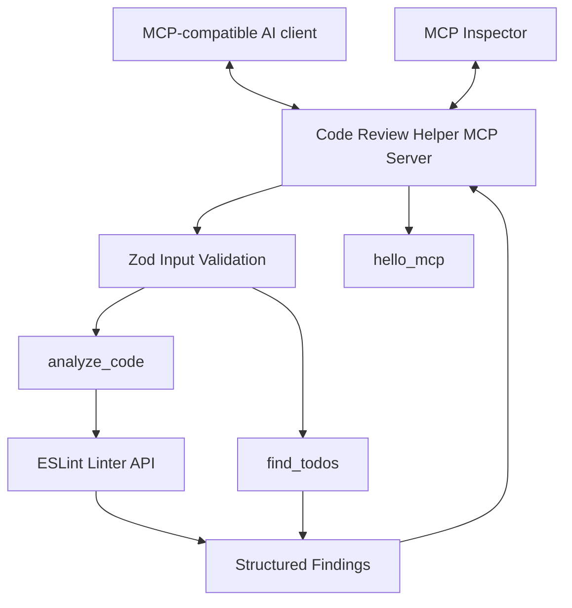

# Code Review Helper MCP

A lightweight **Model Context Protocol (MCP) server** that exposes JavaScript code-analysis tools to MCP-compatible AI assistants.

Built with JavaScript and Node.js, this project integrates ESLint to identify common code-quality issues and provides tools for finding unfinished work in source code.

## Features

- **MCP tool integration** — expose developer utilities through the Model Context Protocol.
- **JavaScript code analysis** — detect undefined variables, unused variables, `var` declarations, console statements, debugger statements, `eval()` usage, and loose equality.
- **TODO scanner** — find `TODO`, `FIXME`, and `HACK` markers in source comments.
- **Structured findings** — return line numbers, columns, severity, rule IDs, and messages.
- **Input validation** — validate tool inputs with Zod and enforce source-size limits.
- **Automated testing** — use Vitest to test analysis logic.
- **Local execution** — analyze submitted code without executing it or sending it to an external AI API.

## Tech Stack

| Technology | Purpose |
|---|---|
| JavaScript (ES modules) | Application development |
| Node.js | JavaScript runtime |
| Model Context Protocol SDK | MCP server and tool registration |
| ESLint | JavaScript static analysis |
| Zod | Input validation |
| Vitest | Automated testing |
| MCP Inspector | Tool discovery and testing |

## Architecture



The MCP server exposes tools over standard input/output (stdio). The client invokes a tool, the server validates its input, and the corresponding function returns a structured response.

## Project Structure

```text
code-review-helper-mcp/
├── src/
│   ├── index.js
│   ├── tools/
│   │   ├── analyze-code.js
│   │   └── find-todos.js
│   ├── utils/
│   └── security/
├── tests/
│   ├── analyze-code.test.js
│   └── find-todos.test.js
├── examples/
│   └── sample-code.js
├── eslint.config.js
├── .gitignore
├── package.json
├── package-lock.json
└── README.md
```

The structure reflects the intended layout; optional folders may be absent if they do not contain files.

## Prerequisites

- A supported Node.js LTS release
- npm
- Git
- An MCP-compatible client or MCP Inspector

## Installation

Clone the repository:

```bash
git clone https://github.com/YOUR_USERNAME/code-review-helper-mcp.git
cd code-review-helper-mcp
npm install
```

Replace `YOUR_USERNAME` with your GitHub username.

## Available MCP Tools

### 1. `hello_mcp`

Verifies that the server can receive a tool call and return a response.

**Input**

```json
{
  "name": "Developer"
}
```

**Example response**

```text
Hello, Developer! Your Code Review Helper MCP server is working.
```

### 2. `analyze_code`

Analyzes a JavaScript source snippet using a predefined ESLint configuration.

**Input**

```json
{
  "code": "var total = missingValue; console.log(total);"
}
```

**Checks include**

- Undefined variables
- Unused variables
- Unexpected `var` declarations
- Console statements
- Debugger statements
- `eval()` usage
- Loose equality comparisons

**Response structure**

```json
{
  "language": "javascript",
  "linesAnalyzed": 1,
  "findingCount": 3,
  "errorCount": 1,
  "warningCount": 2,
  "findings": [
    {
      "line": 1,
      "column": 1,
      "severity": "warning",
      "rule": "no-var",
      "message": "Unexpected var, use let or const instead.",
      "code": "var total = missingValue; console.log(total);"
    }
  ],
  "note": "Analysis uses ESLint rules. Review findings before treating them as confirmed bugs."
}
```

The example illustrates the response format. Actual findings depend on the submitted source and enabled rules.

### 3. `find_todos`

Scans source text for `TODO`, `FIXME`, and `HACK` markers.

**Input**

```json
{
  "code": "// TODO: add input validation\n// FIXME: handle errors"
}
```

**Example response**

```json
{
  "linesScanned": 2,
  "findingCount": 2,
  "findings": [
    {
      "line": 1,
      "tag": "TODO",
      "message": "add input validation",
      "code": "// TODO: add input validation"
    },
    {
      "line": 2,
      "tag": "FIXME",
      "message": "handle errors",
      "code": "// FIXME: handle errors"
    }
  ],
  "note": "Scans single-line comments and single-line block comments. This initial implementation does not parse JavaScript syntax."
}
```

The TODO scanner currently uses pattern matching rather than a JavaScript parser. It can produce false positives for comment-like text inside strings and does not fully support multiline block comments.

## Running the Project

### Start with MCP Inspector

From the project root, run:

```bash
npx @modelcontextprotocol/inspector node src/index.js
```

Open the local URL printed in the terminal.

1. Connect to the MCP server.
2. Open the Tools section.
3. Select **List Tools**.
4. Choose `hello_mcp`, `analyze_code`, or `find_todos`.
5. Enter the required arguments and invoke the tool.

The server uses stdio transport, so its protocol messages are communicated through standard input/output.

## Testing

Run the automated test suite:

```bash
npm test
```

Run ESLint against the application and tests:

```bash
npx eslint src tests
```

The test suite covers the analysis rules, TODO marker detection, line numbers, multiple findings, and edge cases.

## Design Decisions

- **Separation of concerns:** analysis functions live separately from MCP registration and transport.
- **Deterministic analysis:** the initial implementation uses predefined ESLint rules rather than requiring an LLM.
- **Input validation:** Zod validates submitted code and limits its size.
- **No code execution:** submitted source snippets are analyzed as text and are not executed by the analyzer.
- **Structured responses:** findings are returned as JSON to support integration with MCP-compatible clients.

## Limitations

- The analyzer focuses on JavaScript snippets rather than complete multi-file projects.
- ESLint findings are not a complete security audit and may require developer judgment.
- Snippets are analyzed in isolation, so project-wide context is unavailable.
- The TODO scanner uses regular expressions and can produce false positives.
- The server currently uses local stdio transport and does not implement remote authentication.

## Roadmap

- [x] Create an MCP server using Node.js.
- [x] Implement a server connectivity tool.
- [x] Integrate ESLint-based JavaScript analysis.
- [x] Add automated tests with Vitest.
- [x] Implement a TODO/FIXME/HACK scanner.
- [ ] Add naming-convention checks.
- [ ] Add source-file summaries.
- [ ] Improve TODO scanning with proper JavaScript parsing.
- [ ] Implement safe local-file analysis with directory restrictions.
- [ ] Add GitHub Actions continuous integration.
- [ ] Explore optional AI-generated code-review explanations.

## Security Considerations

- Submitted source code is treated as untrusted input.
- The analyzer does not execute submitted JavaScript.
- Input-size limits reduce exposure to oversized requests but are not a complete denial-of-service defense.
- Future file-reading tools should restrict access to explicitly authorized directories.
- Avoid submitting confidential source code to external services without authorization.

## Contributing

Contributions, bug reports, and suggestions are welcome.

1. Fork the repository.
2. Create a feature branch.
3. Add or update tests.
4. Run `npm test` and `npx eslint src tests`.
5. Submit a pull request with a clear description of the changes.

## License

This project is available under the MIT License if the repository includes a matching `LICENSE` file. Ensure the license declaration and file are consistent before publishing.

---

**Built as a learning project exploring MCP server development, JavaScript static analysis, developer tooling, and AI-assisted software engineering.**