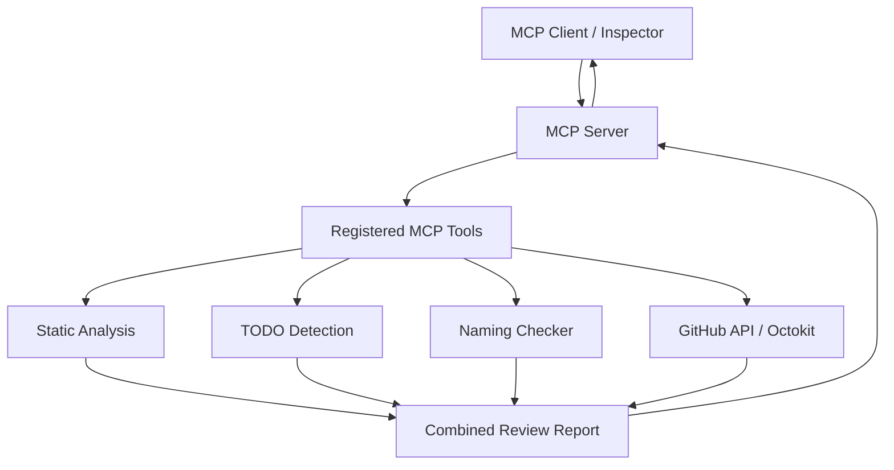

# Code Review Helper MCP

An AI-assisted code review tool built with JavaScript, Node.js, and the Model Context Protocol (MCP). It analyzes JavaScript source code, identifies common issues, finds TODO comments, checks naming conventions, and can review files directly from GitHub repositories.

## Features

- **Static analysis** — detect common JavaScript issues using ESLint.
- **TODO detection** — identify `TODO`, `FIXME`, and `HACK` comments using an AST-aware parser.
- **Naming conventions** — validate `camelCase`, `PascalCase`, and module-level `CONSTANT_CASE`.
- **Combined code review** — consolidate findings from all checks into a structured report.
- **GitHub integration** — retrieve repository files and review their source code.
- **Repository browsing** — list files and directories before selecting a file to review.
- **Actionable recommendations** — provide suggestions for addressing detected issues.
- **Automated tests** — validate tool behavior using Vitest.

## Tech Stack

- Node.js
- JavaScript (ES modules)
- Model Context Protocol SDK
- ESLint
- Acorn
- Octokit REST API
- Zod
- Vitest

## Available MCP Tools

| Tool | Description |
|---|---|
| `hello_mcp` | Verify that the MCP server is responding. |
| `analyze_code` | Analyze JavaScript source using ESLint rules. |
| `find_todos` | Find TODO, FIXME, and HACK comments. |
| `check_naming_conventions` | Check JavaScript naming conventions. |
| `review_code` | Run all code review checks and return a combined report. |
| `review_github_file` | Fetch and review a JavaScript file from GitHub. |
| `list_github_files` | List files and directories in a GitHub repository. |

## Architecture



## Prerequisites

- Node.js and npm
- Git
- A GitHub account for accessing your repositories
- MCP Inspector or another compatible MCP client

## Installation

Clone the repository:

```bash
git clone https://github.com/pratheeshps/code-review-helper-mcp.git
cd code-review-helper-mcp
```

Install dependencies:

```bash
npm install
```

## Configuration

### GitHub access

Public repositories can be accessed without authentication, subject to GitHub API rate limits.

For private repositories, set a GitHub personal access token with the minimum required repository permissions.

macOS/Linux:

```bash
export GITHUB_TOKEN="your_github_token"
```

Set this variable in the environment used to launch the MCP server. Never commit tokens or other secrets to Git.

## Running the MCP Server

Start the server using the start script configured in `package.json`. For example, if the script is named `start`:

```bash
npm start
```

The server uses the MCP stdio transport. When connecting it to an MCP client, configure the client to launch the server process rather than treating it as a regular HTTP service.

## Testing

Run the complete test suite:

```bash
npx vitest run
```

Run ESLint:

```bash
npx eslint src tests
```

Run a specific test file:

```bash
npx vitest run tests/check-naming.test.js
```

## Example: Review JavaScript Code

Call `review_code` with a source-code argument:

```javascript
const user_name = "Alex";

// TODO: Validate input
function Calculate_Total() {
  var total = 10;
  console.log(total);
  return total == null ? 0 : total;
}
```

The report can include:

- ESLint findings
- TODO comment findings
- Naming convention violations
- Severity counts
- Recommendations for resolving issues

## Example: Browse a GitHub Repository

Use `list_github_files` to inspect a repository:

```json
{
  "owner": "pratheeshps",
  "repo": "code-review-helper-mcp",
  "path": "src/tools"
}
```

Use the returned repository-relative path with `review_github_file`:

```json
{
  "owner": "pratheeshps",
  "repo": "code-review-helper-mcp",
  "path": "src/tools/find-todos.js"
}
```

The tool fetches the file and passes its source to the combined review engine.

## Project Structure

```text
code-review-helper-mcp/
├── src/
│   ├── index.js
│   └── tools/
│       ├── analyze-code.js
│       ├── find-todos.js
│       ├── check-naming.js
│       ├── review-code.js
│       ├── github-file.js
│       └── list-github-files.js
├── tests/
├── eslint.config.js
├── package.json
└── README.md
```

## Security Considerations

- Never hardcode or commit GitHub access tokens.
- Use least-privilege GitHub permissions.
- Validate tool inputs and enforce source-size limits.
- Do not execute fetched repository code.
- Treat repository source code and comments as untrusted input.
- Keep GitHub API errors and authentication details from exposing secrets.

## Current Limitations

- GitHub review supports individual JavaScript files, not a complete pull request review workflow.
- The current source-size limit is 20,000 characters.
- Naming checks focus on variable, function, and class declarations.
- JSX and TypeScript require additional parser support.
- GitHub API rate limits can affect unauthenticated requests.

## Roadmap

- [ ] Review changed files in GitHub pull requests.
- [ ] Add configurable code review rules.
- [ ] Improve finding deduplication and severity configuration.
- [ ] Add more AST-based rules.
- [ ] Generate review summaries suitable for pull request discussions.
- [ ] Add CI integration and GitHub Actions support.

## License

Add your chosen open-source license here, such as MIT, if you intend to distribute the project under that license.

## Author

**Pratheesh P S**

GitHub: [@pratheeshps](https://github.com/pratheeshps)
