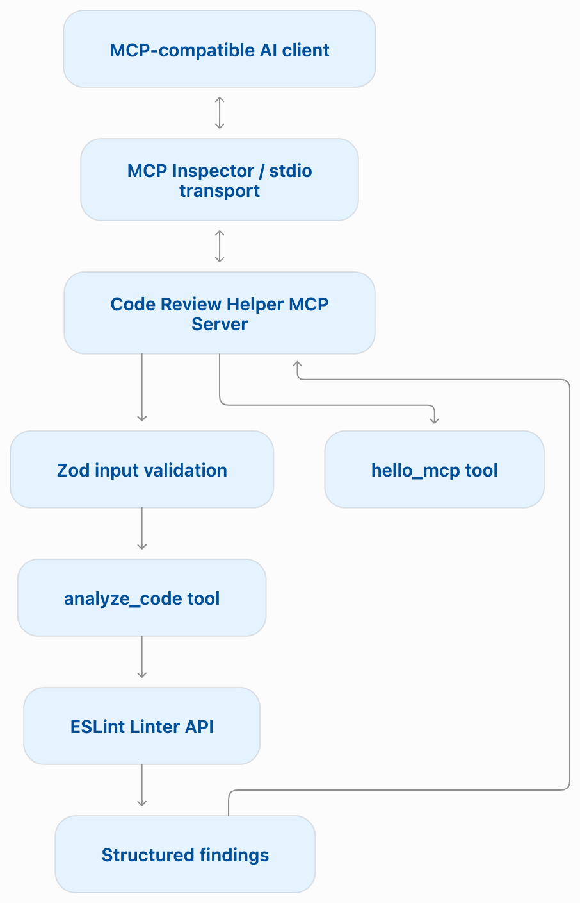

flowchart TD
    A["MCP-compatible AI client"]
    B["MCP Inspector / stdio transport"]
    C["Code Review Helper MCP Server"]
    D["Zod input validation"]
    E["analyze_code tool"]
    F["ESLint Linter API"]
    G["Structured findings"]
    H["hello_mcp tool"]

    A <--> B
    B <--> C
    C --> D
    D --> E
    E --> F
    F --> G
    C --> H
    G --> C

